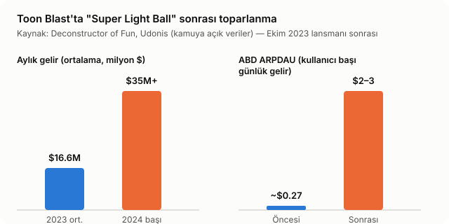

# Toon Blast Live-Ops Case Study

**Bir yeni-mezun product specialist perspektifiyle:** Toon Blast'ın mevcut monetizasyon/live-ops stratejisini inceleyip, oyuncu şikayetlerini büyütmeden yeni bir gelir katmanı ekleyecek bir live-ops konsepti öneriyorum.

> Bu, Peak'e **New Grad Product Specialist** başvurum için hazırladığım bağımsız bir vaka çalışmasıdır. Şirket içi/gizli hiçbir veri kullanılmamıştır — tamamen kamuya açık kaynaklardan (basın, oyuncu yorumları, sektör raporları) derlenmiştir. Amaç, ürün düşünme biçimimi somut bir örnek üzerinden göstermektir.

---

## TL;DR

Toon Blast, Ekim 2023'te eklediği **Super Light Ball** özelliğiyle ABD ARPDAU'sunu ~10 kat artırdı — ama bunu "daha fazla güç ver" ile değil, "kaybetmek istemeyeceğin bir varlık" (loss aversion) mantığıyla yaptı. Aynı zamanda oyuncu yorumlarında "agresif monetizasyon" ve "satın alma güven sorunları" tekrar eden şikayetler olarak öne çıkıyor. Bu ikisinin arasında bir boşluk görüyorum: **mevcut oyuncuyu daha çok sıkmadan, geri gelmeyi teşvik eden yeni bir satın alma anı yaratmak.**

Önerim: **"Kayıp Kasa" (Comeback Vault)** — zorlukla değil, dönüş davranışıyla tetiklenen, zaman sınırlı bir live-ops etkinliği.

---

## 1. Bağlam: Toon Blast bugün nerede duruyor?

| Metrik | Değer | Kaynak |
|---|---|---|
| Toplam indirme (tüm zamanlar) | 186.7M | Udonis |
| 2025 yıllık gelir | $333M (rekor) | Udonis |
| İndirme başına gelir (RPD) | $12.39 | Udonis |
| Blended ARPDAU | $0.27 | Udonis |
| D30 retention | %10.7 | Udonis |
| Aylık aktif kullanıcı (2026) | 6.6M | Udonis |

Son 3 yılda hikaye şu: indirmeler zirveden **%90+ düştü**, ama aylık gelir neredeyse hiç düşmedi (2023'te ~$16.6M/ay ortalamadan, 2024 başında $35M+/aya çıktı). Bu, Peak'in **ölçekten değer üretmeye** geçtiğinin açık kanıtı — küçülen ama çok daha sadık/parasal olarak değerli bir oyuncu tabanı.

## 2. Zaten iyi çalışan ne var?

Rakamların arkasındaki mekanizmaları anlamak, "boş yere tekerleği yeniden icat etmemek" için önemli:

- **Super Light Ball (Ekim 2023):** Oyuncunun en güçlü özel taşını ve kombinlerini ikiye katlayan bir mekanik. İşe yaramasının sebebi güç enflasyonu değil — "artık sahip olduğun ve kaybetmek istemediğin bir şey" hissi yaratması (loss aversion).
- **Live-ops takviminin yeniden yapılandırılması:** Yedi ayrı tek-günlük etkinlik yerine, üst üste binen 2-6 günlük daha uzun formatlara geçildi — bu da sürekli bir "hedefim var" hissi ve daha fazla satın alma fırsatı yarattı.
- **Collection Meta, Wild Journey, 3 katmanlı Season Pass, Cannon Fest:** Her biri farklı bir oyuncu motivasyonuna (biriktirme, ilerleme, statü, mini-oyun çeşitliliği) hitap eden tamamlayıcı sistemler.

## 3. Gördüğüm gerilim

Oyuncu yorumlarını taradığımda (App Store / Play Store / topluluk forumları), tekrar eden üç tema var:

1. **"Agresif monetizasyon" yorgunluğu** — ilerlemenin satın almaya bu kadar bağlı olması bazı oyuncuları yoruyor.
2. **Güven sorunları** — bazı kullanıcılar paketlerin hesaplarına tanımlanmadığını, destek ekibinin yanıt vermediğini belirtiyor.
3. **Bağlantı/teknik hatalar yüzünden kaybedilen ilerleme** — bu doğrudan bir retention sızıntısı; parasal değil ama güven ve elde tutma açısından kritik.

Yani soru şu: **Super Light Ball'un başarısını tekrarlayan ama "daha da zorlaştırma" hissi vermeyen, yeni bir gelir katmanını nereye koyarım?**

## 4. Önerim: "Kayıp Kasa" (Comeback Vault)

**Mekanik:**

- Her oyuncu normal oynarken pasif olarak "kasa puanı" biriktirir (ücretsiz, oynamaya bağlı — satın alma şartı yok).
- Oyuncu **48 saat** boyunca oyuna dönmezse, kasa puanı yavaşça azalmaya başlar (ama sıfırlanmaz — sadece "erirse ne kaybederim" hissi verir).
- Tek, makul fiyatlı bir **"Kasayı Kilitle"** satın alması: (a) erimeyi durdurur, (b) etkinlik süresince dolum hızını artırır.
- Etkinlik sonunda kasa, gerçek oyun içi ödüllere (booster, hayat, coin) çevrilir.

**Neden bu ve neden böyle?**

- Loss aversion mantığı Super Light Ball'la aynı — ama bir "güç" değil, bir "zaman penceresi" üzerine kurulu. Bu da onu zorluk artışı olarak değil, **geri dönüş teşviki** olarak konumlandırıyor — "agresif monetizasyon" şikayetini büyütmek yerine, churn riski taşıyan oyuncuya yönelik ayrı bir davranışsal segment hedefliyor.
- Peak'in zaten kanıtlanmış "üst üste binen, uzun etkinlik" takvim formatına ekleniyor — yeni bir kalıcı sistem değil, mevcut event motoruna bir modül.
- Collection Meta ya da Wild Journey gibi kalıcı sistemlerle çakışmıyor; onları büyütmüyor, üstüne binmiyor.

## 5. Başarı Metrikleri

| Metrik | Ne için |
|---|---|
| Etkinliğe katılım oranı | Konseptin genel ilgi çekip çekmediği |
| "Kasayı Kilitle" dönüşüm oranı | Yeni gelir katmanının gerçek etkisi |
| Etkinlik penceresinde ARPDAU değişimi (kontrol grubuna karşı) | Gelir etkisinin net ölçümü |
| Hedef kohortun (churn riskli D7-D30) etkinlik sonrası D7 dönüş oranı | Retention etkisi — asıl amaç bu |
| Yorumlarda "agresif monetizasyon" şikayet oranı (önce/sonra) | Marka/algı riskinin izlenmesi |

**Guardrail metrikler:** uninstall oranı, iade oranı, faturalama ile ilgili destek talebi hacmi — bunlardan biri kötüleşirse konsept "hayır" demeli, ARPDAU ne kadar iyi görünürse görünsün.

## 6. Test planı (özet)

1. **Küçük pazar testi** (ör. tek bir orta ölçekli lokalizasyon) — global öncesi sinyal almak için.
2. **A/B/kontrol yapısı:** churn riskli kohort içinde, etkinliği görmeyen bir kontrol grubu tutmak — asıl soru "bu olmasaydı bu oyuncular zaten geri gelir miydi?"
3. **Kademeli genişletme:** guardrail metrikler temiz kalırsa daha geniş kohortlara ve pazarlara yayma.

## 7. Riskler ve açık sorular

- **Kanibalizasyon riski:** Kasa satın alması, mevcut booster/coin paketlerinin yerini mi alır yoksa onlara ek mi olur? Gerçek segment/harcama verisi olmadan bunu kesin bilemem.
- **Konumlandırma riski:** "İlerlemeni kaybetme" mesajı yanlış kurgulanırsa, tam da kaçınmaya çalıştığım "agresif monetizasyon" algısını güçlendirebilir — metin/görsel tasarımı kritik.
- **Segment büyüklüğü belirsizliği:** Hangi oyuncu diliminin gerçekten "churn riskli ama kazanılabilir" olduğunu, gerçek elde tutma verisi olmadan varsayımla belirledim.

Bu son üç madde tam olarak, gerçek şirket içi veriye erişimim olsaydı ilk doğrulayacağım şeyler.

---

## Yöntem notu

Bu case study, aşağıdaki kamuya açık kaynaklardan derlenmiştir. İçindeki hiçbir sayı veya alıntı Peak'in iç verisi değildir:

- [How Toon Blast Became the Best Business in Puzzle — Deconstructor of Fun](https://www.deconstructoroffun.com/blog/how-toon-blast-became-the-best-business-in-puzzle)
- [Toon Blast Revenue and Downloads Statistics — Udonis](https://www.blog.udonis.co/statistics/toon-blast)
- [Toon Blast — Ratings & Reviews, App Store](https://apps.apple.com/my/app/toon-blast/id1176027022?see-all=reviews&platform=undefined)
- [Toon Blast game monetization and difficulty issues — oyuncu topluluğu tartışması](https://www.facebook.com/groups/2737963116484697/posts/4016757425271920/)

---

*Lara Önat — [Mind Closet of L](https://laraonat12.github.io/mind-closet-of-l/) adlı kişisel blogumu da GitHub üzerinden yönetiyorum.*
